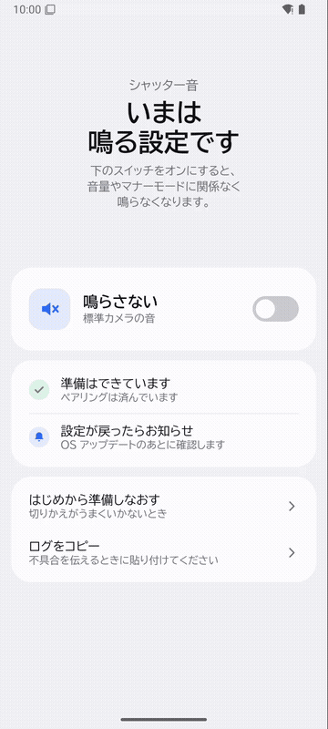
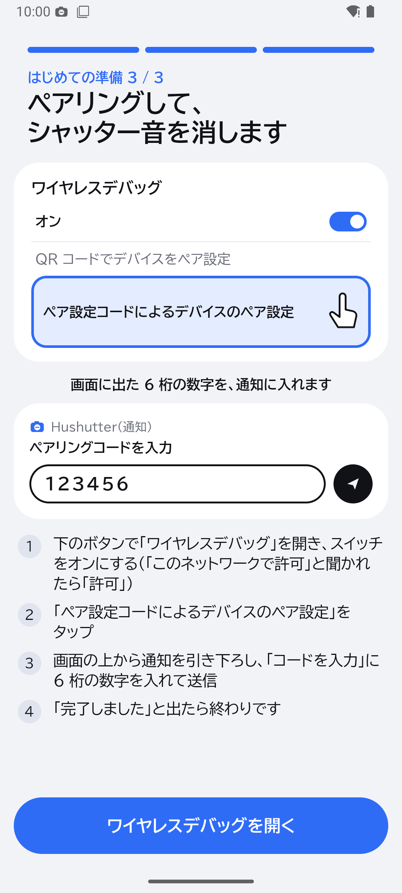
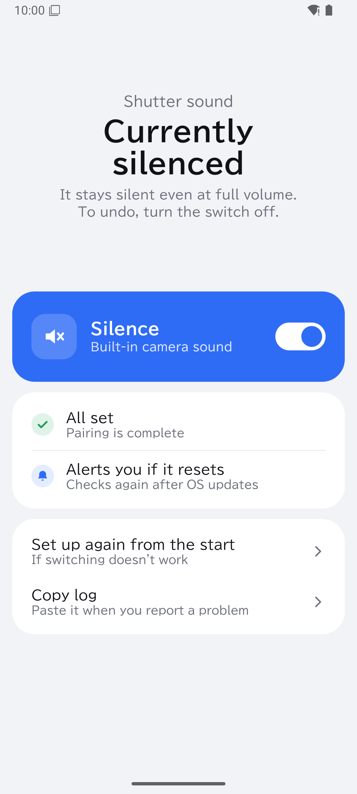

# Hushutter



日本向け Galaxy の標準カメラのシャッター音を、音量やマナーモードに関係なく消すアプリです。スマホだけで完結し、PC・root・Shizuku は使いません。

[English](#english)

> ⚠️ 個人用に作ったものを公開しています。動作確認は限られた環境のみで、不具合があっても対応できない場合があります。自己責任でお使いください。
>
> 日本向けの端末でシャッター音が鳴るのは、盗撮を防ぐための業界の自主規制です。他人を無断で撮影することには使わないでください。

## できること

- スイッチ 1 つで、標準カメラのシャッター音を「鳴らさない／鳴らす」に切りかえ
- 音量を上げたままでも、マナーモードにしなくても鳴りません
- 最初の準備は、設定画面のミニ図つきのガイドどおりに進めるだけ（3 ステップ）
- 2 回目以降は、ワイヤレスデバッグのオン/オフもアプリが自動で行います
- OS アップデートで設定が戻ったら、再起動後に通知でお知らせ。タップで再設定
- 日本語・英語に対応

  

## 導入方法

1. [Releases](../../releases) から最新の APK をダウンロード
2. 「設定 → セキュリティおよびプライバシー → 自動ブロッカー」をオフにしてからインストール
3. アプリを開き、「はじめての準備」に沿って進める
   1. 開発者向けオプションをオンにする（「ビルド番号」を 7 回タップ）
   2. Wi-Fi につなぐ
   3. ワイヤレスデバッグの「ペア設定コードによるデバイスのペア設定」を開き、通知に 6 桁のコードを入れる
4. （任意）[Obtainium](https://github.com/ImranR98/Obtainium) にこのリポジトリの URL を登録すると、自動で更新されます

## しくみ

Android の「ワイヤレスデバッグ」で、スマホの中で自分自身に adb 接続し、次のコマンドを実行しています。外部のサーバーとは通信しません。

```
settings put system csc_pref_camera_forced_shuttersound_key 0   # 強制シャッター音を解除
appops set com.sec.android.app.camera PLAY_AUDIO ignore          # 標準カメラアプリの音を、音量に関係なく止める
pm grant io.github.sabopura.hushutter android.permission.WRITE_SECURE_SETTINGS  # 次回からワイヤレスデバッグを自動でオン/オフするため
```

スイッチをオフにすると、どちらの設定も元に戻ります。

## 確認済みの環境

- Android 16（エミュレーター）、Android 11（エミュレーター）：準備ガイド、ペアリング、切りかえ、元に戻す、画面の回転、通知の許可を拒否した場合
- 作者の Galaxy（開発中の版でシャッター音が消えることを確認）

エミュレーターでは、Galaxy の標準カメラの代わりに同じパッケージ名のダミーアプリを使っています。

## ソースからビルドする

```
./gradlew assembleRelease
```

署名用の設定ファイルがない環境では、debug 鍵で署名された APK ができます。

## ライセンス

MIT（無保証）。同梱しているライブラリとフォントのライセンスは [THIRD_PARTY_NOTICES.md](THIRD_PARTY_NOTICES.md) を見てください。

---

## English

Hushutter silences the built-in camera shutter sound on Japanese-market Samsung Galaxy phones, regardless of the volume or sound mode. Everything happens on the phone: no PC, no root, no Shizuku.

> ⚠️ This is a personal project shared as-is, tested only on a few setups, with no warranty. Use it at your own risk.
>
> Japanese phones play the shutter sound as an industry measure against secret photography. Do not use this app to photograph people without their consent.

**Features**

- One switch to silence the built-in camera shutter sound, or turn it back on
- Stays silent at full volume, without silent mode
- First-time setup is a 3-step guide with pictures of the Settings screens
- After that, the app turns wireless debugging on and off by itself
- If an OS update resets the setting, you get a notification after reboot; tap it to silence again
- Japanese and English

**Install**

1. Download the latest APK from [Releases](../../releases)
2. Turn off Settings → Security and privacy → Auto Blocker, then install it
3. Open the app and follow the setup guide (Developer options → Wi-Fi → pair with the 6-digit code from the notification)
4. Optional: add this repository to [Obtainium](https://github.com/ImranR98/Obtainium) for automatic updates

**How it works**

The app uses Android's wireless debugging to open an adb connection to the phone itself and runs the commands shown above. It does not talk to any outside server.

**License**

MIT (no warranty). Third-party licenses are listed in [THIRD_PARTY_NOTICES.md](THIRD_PARTY_NOTICES.md).
